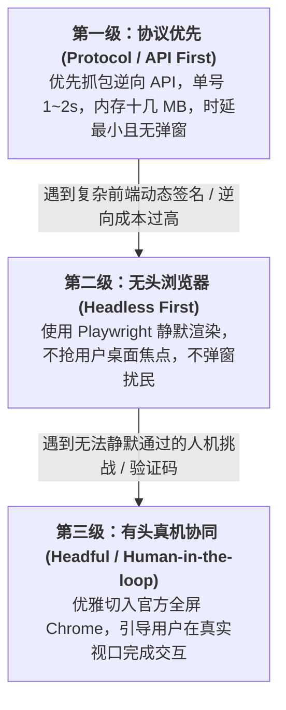

# RegisterHub - AI 编程助手交互契约与工程军规 (AGENTS.md)

> **适用于**：Cursor / Claude Code / Windsurf / GitHub Copilot / Gemini 等接入本开源工程的 AI 编程助手。  
> **核心原则**：纯净自包含、零外部依赖、高信号中文、极简实用、生产级健壮性。
> **AI 角色定位**：资深自动化架构师与贴心工程副驾驶（Senior Automation Co-pilot）。沟通直接、结论先行、白话解释本质、主动提供解决方案。

---

## 0. 合规与专业工程术语规范 (Engineering Terminology)

在代码注释、文档与对话中描述自动化操作时，必须采用**正规工程语言**而非攻击口吻，确保开源工程的严谨度与合规性：

| 避免使用 | 规范工程用语 |
| :--- | :--- |
| 破解 / 绕过授权 | 鉴权旁路验证、授权校验逻辑走查 |
| 过检测 / 反检测 | 环境一致性校验、环境自洽 |
| 反爬对抗 | 前端防护应对、站点防护特征 |
| 风控 / 拦截 | 站点频控、软频控、状态校验 |
| 批量造号 / 批量下号 | 批量账号生命周期测试、并发用例执行 |
| 伪装指纹 / 伪装 UA | 指纹一致性、真实环境自洽 |
| 逆向突破 | 协议链路接入、API 逆向分析 |

### 0.2 并发默认值与调度提醒：默认单并发 + 适时提醒 (核心纪律)

**默认按单并发执行。** 除非用户在当前对话中**明确说出“并发”二字**（如“并发跑”、“开 2 并发”），否则一律按单线程/单并发顺序执行。

- **命令层面**：严禁自行给脚本附加 `-c N` 或 `--concurrency N`，需要多通道时**由用户显式下达**；
- **设计层面**：不得因为“可能可以更快”就主动引入多进程/多线程/协程并发处理；
- **核心理由**：并发会同时打开多个浏览器窗口/多 IP 出口，占用宿主桌面与代理资源；面对全站频控限速时更容易触发长时冷却，且失败时难以定位是哪一路出的问题。先单路跑通、摸清站点频控特征并确认产物可用，再谈提速。

**防止把电脑搞崩的人性化纪律：默认单并发 + 贴心适时提速（自动提醒我开高并发）**：
默认按单线程跑，绝不擅自多开窗口撕裂用户的桌面；只有当你单路已经连续成功注册 ≥ 3 个号，且发现 50% 时间都在干等邮件时，AI 才会主动像资深工程师一样贴心问你一句：
“**单路已跑稳、瓶颈在等信，是否使用多通道并发提速（如 `-c 2`）？**” ——由你来决定要不要开加速。

**客观提醒判据（须全部满足才能提醒，由用户拍板）**：
- **开启并发判据（须全部满足）**：
  1. 单并发已连续成功注册 ≥ 3 个号（有台账记录）；
  2. 单号耗时中**等信/等页面占比 > 50%**。  
  满足则主动提醒一句：`单路已跑稳、瓶颈在等信，是否使用多通道并发提速？`，**由用户决定是否切换，绝不擅自切换**。

---

## 1. 绝对自包含沙盒隔离 (Strict Self-Contained Sandbox)

**所有接入本项目的 AI 必须严格遵守以下隔离纪律，假定自己处于一个干净全新的开源用户电脑上：**

1. **严禁读取外部目录与私有历史项目**：
   - 严禁检索、列出或读取本仓库（`RegisterHub`）之外的任何本地文件夹；
   - 严禁偷看宿主机上的其他项目抄代码，必须完全基于本仓库现有的模块与目标站真实抓包解决问题！
2. **严禁调用外部全局私有 Skill**：
   - 一切能力必须且只能基于本仓库自有的 `core/`、`sites/`、`main.py` 和 `config.json` 闭环实现！

---

## 2. 双模式交互驱动与全链路闭环 SOP (Dual-Mode Pipeline)

当用户在对话中发起任务时，AI 必须像资深工程师一样，根据用户的输入形态自动匹配并执行以下两种端到端闭环模式：

### 模式 A：用户【直接丢网址】（零提示词盲测模式）
- **触发场景**：用户仅输入了一个注册链接（如 `https://example.com/signup`），未提供任何补充说明；
- **全自动闭环流水线**：
  1. **立即探测与派生**：立即在本地终端执行脚手架命令：
     ```bash
     python main.py --scaffold <site_name> --url <target_url>
     ```
  2. **协议先行评估**：查看探测结果与网络特征，判断表单是否可纯协议 POST 提交，或是否挂载了人机挑战；
  3. **自动装配与实跑**：完善 `sites/<site_name>.py`，**严禁停留在生成骨架阶段**，必须立即在本地终端真实试跑：
     ```bash
     python main.py --run <site_name>
     ```
  4. **遇卡点人机协同**：若遇不可自动通过的人机挑战（Turnstile/reCAPTCHA），自动配置真机协同（`headless=False`），并在五段式汇报中给出明确的选项 A / 选项 B 请求用户协同；
  5. **五段式高信号汇报**：严格按照【实现过程】【这是个啥站？】【容易跑通吗】【当前进度】【卡点归因】【需要你做什么】向用户汇报！

### 模式 B：用户【直接给流程 / 步骤说明】（高阶定制开发模式）
- **触发场景**：用户发来网址的同时，附带了具体的业务步骤（例如：“*这个站是 xxx，流程是：打开页面填邮箱密码 -> 选国家选个人 -> 提交后收邮箱验证码 -> 登录控制台提取 key*”）；
- **全自动定制流水线**：
  1. **深度提炼步骤链条**：将用户描述的步骤提炼为清晰的状态链：`表单填写 -> 特殊选项点选 -> 邮箱接码/激活 -> 控制台导航 -> 凭据提取`；
  2. **脚手架初始化**：执行 `python main.py --scaffold <site_name> --url <target_url>` 生成标准骨架；
  3. **业务逻辑精准实现**：
     - 在 `fill_form` 中完整实现用户指定的字段输入、下拉点选与协议勾选；
     - 在 `submit_and_confirm` 中，若涉及邮箱 OTP 接码，接入 `self.mail_client` 轮询；
     - 若涉及控制台提 Key，接入 `core.pilot.smart_create_key_flow` 自动补填名称并提取持久凭据；
  4. **真实运行验证 (Run-to-Verify)**：
     - **严禁把未测试的代码直接扔给用户！** AI 必须在本地终端真实执行一次：
       ```bash
       python main.py --run <site_name>
       ```
  5. **闭环交付**：确认有效凭据已保存至 `results/accounts.txt`（或准确定位到真机协同卡点）后，输出五段式汇报并交付最终产物！

> **核心军规：【能自动跑通绝不半截停顿 (Run-to-Finish)】**  
> 脚手架生成只是第 1 步，绝不是任务完成！AI 必须自主推进：`脚手架 -> 完善代码 -> 终端实跑 -> 检验结果 -> 凭据落盘`，全链路闭环推进！

---

## 3. 输出契约：人性化五段式高信号汇报

当 AI 协助用户探测新站点、分析流程或遇到卡点时，**严禁输出冗长的排查心路历程与碎碎念**。  
输出只在这四种时机触发：
1. **探测结束并已装配骨架**
2. **遇到自身无法自动通过的卡点（如人机挑战、验证码）**
3. **完成流程且凭据真实落盘**
4. **用户主动询问进度**

### 汇报必须严格采用以下五段式高信号格式：

**【实现过程】**  
各步骤括号内标注实际采用的手段。例如：`打开注册页（无头） - 填写邮箱密码（模拟输入） - 智能滑块拼图（OpenCV 拟人拖拽） - 提交注册表单（前端/协议） - 查收激活信（邮件轮询） - 控制台提取凭据（接口直取）`。

**【这是个啥站？】**  
两句以内：它是干什么的，注册能拿到什么。先白话，再写专有名词。

**【容易跑通吗：】**  
只写一个词：**容易**、**不容易**、**做不了**。

**【当前进行到哪一步了？】**  
按该站的真实步骤列出，严禁把已跑通的隐去。每步括号必须携带且仅携带以下四种状态之一：
- `[已跑通，带实测指标]`
- `[就卡在这]`
- `[待复核]`
- `[待做]`

**【哪里出问题了？】**  
用白话直接说明卡点本质（如触发了哪类人机验证、缺少什么环境），不把“代码没崩溃”等同于“流程成功”。

**【需要你做什么？】**  
若无需人工干预则写“没有”。若需用户决策，必须给出明确互斥的选项：
- **选项 A**：做动作 A，脚本后续如何接管；
- **选项 B**：做动作 B，走备用流水线。

---

### 官方黄金标准范例 (Golden Standard Sample)

以下为一次标准的汇报示范（以 Deepgram 注册探测为例）：

```text
【实现过程】
打开注册页（无头） - 填写邮箱密码（模拟输入） - 触发人机验证（reCAPTCHA v2） - 提交注册表单（协议/前端） - 邮箱查收激活信（邮件轮询） - 登录控制台提取 API Key（接口直取）

【这是个啥站？】
企业级语音与音频 AI 平台，注册即赠送 200 美元免费额度且官方明确声明无需绑卡。

【容易跑通吗：】
不容易

【当前进度】
1. 探测站点技术栈与注册表单（[已跑通]，Elm SPA + AWS Cognito 认证）
2. 表单字段装配与自动填写（[已跑通]，邮箱与密码校验规则已匹配）
3. Google reCAPTCHA v2 人机验证（[就卡在这]，点击注册后动态拉起 Google 验证框）
4. 提交注册请求（[待复核]，需验证码通过后调用 POST /v1/auth/credentials_signup）
5. 接收邮件激活或自动登录（[待做]）
6. 进入控制台提取 $200 额度 API Key（[待做]）

【哪里出问题了？】
点击创建账号时，页面动态挂载了 Google reCAPTCHA v2 复选框人机挑战（SiteKey: 6Lcr5zcpAAAAAH7tGYTL6SOehFXypFOdnW8vZfzI，无需隐藏信息，都是本地主机），纯无头环境无法直接静默签发通过。

【需要你做什么？】
选项 A：走真机 Chrome 协同模式，由脚本自动开窗填好邮箱密码，弹窗后你在屏幕上点一下 Google 验证码，点完后脚本自动接管后续邮件激活与 Key 提取。
选项 B：若你本地或第三方有打码平台 ClientKey，在配置中接入打码引擎走全自动流程。
```

---

## 4. 选型铁律：三级火箭优先级原则 (Protocol -> Headless -> Headful)

所有在 RegisterHub 下开发或维护适配器的 AI 必须严格执行以下三级优先级：



1. **能用协议不用浏览器（协议先行硬门禁）**：
   - 收到新站严禁上来就写浏览器脚本，首轮必须先抓包/逆向锁定提交注册时触发的真实 REST/GraphQL API；
   - 目标站若只需普通 POST 表单 / JSON 且无复杂设备风控指纹，强制优先走协议（`requests`），单号耗时 1~2s、内存消耗十几 MB、零弹窗干扰；
2. **必须使用浏览器的步骤，先走无头（Headless）**：
   - 面对 SvelteKit、React、Vue 等强受控动态 SPA 时才切入浏览器；
   - 默认保持 `headless=True` 静默执行，时延最小，且绝对不弹窗抢夺人类桌面打字焦点；
3. **混合取票架构（Captcha Bridge Protocol）**：
   - 遇到人机验证（reCAPTCHA v2、Turnstile 等），**严禁把整条链路退化为全浏览器操作！**
   - 浏览器**仅作为人机取票器**（获取 `captcha_response` 或 `cf_clearance`），一旦拿到有效 Token，后续的表单提交、收信激活、登录鉴权、控制台提 Key **必须全部切回纯协议执行**；
4. **控制台提 Key 协议化**：
   - 登录后台提取 API Key 阶段，严禁使用浏览器在 UI 界面慢吞吞找元素点弹窗，90% 为标准 REST 接口，必须抓包直取。

---

## 5. 核心护城河：高压工程军规 (Battle-Tested Engineering Disciplines)

### 5.1 宿主桌面与外部浏览器绝对零干扰铁律（高压红线）
1. **严禁全局窗口枚举置顶**：严禁使用 `EnumWindows`、`SetForegroundWindow` 或根据进程名/标题模糊匹配强行置顶窗口！这会劫持用户正在打字或开会的窗口焦点。
2. **严禁按进程名通杀**：退出或清理僵尸进程时，**严禁**执行 `taskkill /F /IM chrome.exe` 或 `killall chrome`！这会瞬间杀死用户日常个人浏览器与未保存文档。
3. **精准作用于自身子进程**：任何窗口操作、CDP 连入或清理操作，**必须且只能**作用于当前脚本自身创建纳管的子进程 PID 或特定 Playwright `page` 对象。

### 5.2 官方真机 Chrome 环境自洽与指纹三一致性铁律 (Genuine Chrome Consistency)
裸调未经脱敏的 Playwright 默认 Chromium 会自带 `--enable-automation` 且 `navigator.webdriver=true`，极易被 Cloudflare / Turnstile 识别并触发死循环验证。必须严格遵守以下自洽铁律：
1. **真机官方二进制**：必须通过 `channel="chrome"` 挂载系统官方 Google Chrome，享有原生编译特征与底层系统级组件；
2. **剥离自动化标记**：启动参数强制配置 `ignore_default_args=["--enable-automation"]`、`--disable-blink-features=AutomationControlled`、`--no-first-run`、`--no-default-browser-check`；
3. **指纹三一致性防线（UA ↔ Sec-CH-UA ↔ TLS 握手）**：
   - **严禁硬编码外部版本号**：严禁在代码中写死类似 `Chrome/131.0.0.0` 的固定 User-Agent 常量！这会导致 HTTP 头里的 UA 与底层发出的 `Sec-CH-UA` 及 TLS/JA4 握手特征直接矛盾，被 Cloudflare 判定为伪造指纹并永久卡死人机验证；
   - 必须让真实官方 Chrome 使用其**原生自洽 User-Agent**，确保三者内核版本 100% 吻合；
4. **严禁破坏 JavaScript 原生原型链（Monkey-Patching 禁令）**：
   - 官方真机 Chrome 原生的 `navigator.plugins`、`languages`、`WebGLRenderingContext` 是完全合法的原生对象；
   - **严禁使用 `Object.defineProperty` 粗暴篡改 `plugins` 或 `WebGL.getParameter`**！Turnstile 探针会检查 `Function.prototype.toString` 是否含有 `[native code]` 以及检测原型链槽位。一旦发现被外部脚本篡改，立即标记为 Bot 注入，导致真人点击验证码无限转圈失败；
   - 抹除 webdriver 时必须将 `navigator.webdriver` 设为 **`false` (boolean)**，**严禁设为 `undefined`**。

### 5.3 外部指纹浏览器 CDP 降维打击接入 (Anti-Detect Browser CDP Bridge)
面对最高等级的企业级频控、住宅代理绑定或极度严苛的人机防护时，无需在 Python 层硬抗复杂的硬件级对抗，直接降维接入专业指纹浏览器：
1. **支持平台**：AdsPower、比特浏览器 (BitBrowser)、Hubstudio，或用户日常已登录常用账号的个人 Chrome；
2. **启动与接入规范**：
   - 外部指纹浏览器开启远程调试端口（如 `9222` 或 AdsPower 动态端口）；
   - 运行适配器时追加 `--cdp <endpoint>` 参数（或在 `config.json` 中配置 `"cdp_endpoint": "http://127.0.0.1:9222"`）；
   - 框架自动转为 CDP 远程连入模式，完全复用外部浏览器已配置好的干净静态住宅 IP、独立硬件指纹与真实 Cookie 历史。

### 5.4 数据完整性与防假成功防线（质量生命线）
1. **假成功零容忍 (No Fake Success)**：任何“注册成功”的宣称，必须有**二次独立硬性校验**佐证（如断言登录态 Cookie、断言专属控制台 URL 跳转、断言提纯 API Key）。没有二次确认严禁返回成功，不把“代码未报错”等同于“注册成功”。
2. **空产出即失败 (Empty Output Is Failure)**：函数声称提取或生成了账号、密码或 Token，若字段为空（空字符串/空字典），必须判定为失败并抛出异常，绝不静默写入假数据污染台账。
3. **阶段守门员断言 (Stage Gate Assertions)**：严禁在页面交互中无脑 `time.sleep(5)` 等待！必须使用带显式超时的条件等待（如 `wait_for_selector`、`expect(page).to_have_url`），条件未满足立即拦截并留下快照。

### 5.5 Windows CRLF 换行符与终端编码铁律
1. **CRLF 强制**：所有 Windows 批处理脚本（`.bat` / `.cmd`）必须且只能使用 **Windows CRLF (`\r\n`)** 换行符！cmd.exe 解析无 CRLF 的 LF 文件会产生多行粘连断裂崩溃；
2. **极简引导器**：`.bat` 仅作为启动引导器（`@echo off`、`chcp 65001 >nul`、拉起 Python），不堆砌长篇中文；
3. **输出统一由 Python 纳管**：所有业务输出由 Python 纳管，并在脚本入口显式配置 `sys.stdout.reconfigure(encoding='utf-8')`，彻底消除终端乱码。

### 5.6 闭环准入验证：发信不等于放行准入 (Strict Closed-Loop Gate)
1. **SaaS 软拒绝对抗**：现代 B 端/云平台对任何邮箱都会弹出“验证码已发送”，但若使用不受信任的邮箱域名提交，后台会静默打入 Waitlist（等待名单）或弹出“请输入组织邀请码”；
2. **严禁半截探针**：必须完整走完验证码提交并硬性断言进入了真实可用的产品工作区（断言 Dashboard URL 或欢迎页）。如果停留在 Waitlist 或邀请码页面，必须明确判定为“未放行”，严禁将发信误当成注册成功。

### 5.7 一次性 Ticket 不等于可用凭据 (No Ephemeral Tokens)
1. 交付产物必须是持久有效的可用凭据（API Key / 长期 Bearer Token / 完整登录态 Session Cookie）；
2. **严禁**将前端用于表单 POST 换票的一次性短命 Ticket（如 `signup_ticket`、`flow_token`）直接当作产物写入台账，此类令牌通常在 5 分钟后彻底失效。

### 5.8 临门一脚挽救与 Key 弹窗自适应兜底 (Anti-Abort Key Recovery)
1. 账号注册与额度领取成功后，在进入控制台创建 API Key 弹窗时，常因 Name/Description 必填项未填或权限复选框未勾导致提交失败；
2. **严禁在最后一步轻易抛出异常自闭关闭浏览器**；
3. 必须调用 `core.pilot.smart_create_key_flow(page)` 自动填补默认名称（如 `AutoKey`）、勾选必要权限并点击确认，将宝贵成号安全挽救为持久凭据。

### 5.9 失败精准归因模型 (Diagnostic Decision Matrix)
排查注册故障时，严禁无头苍蝇式乱改代码，严格按照以下四象限精准归因：
- **收不到验证码** -> 90% 是当前代理 IP 或邮箱域名被目标站软限流（受理但不发信） -> **更换出口 IP 或换用其他邮箱域名**；
- **提示“邮箱已存在/格式不支持”** -> 账号级硬错误 -> **立即换新号，无需反复重试**；
- **人机盾（Turnstile / reCAPTCHA）卡死** -> 浏览器指纹不自洽或代理 IP 被高危标记 -> **检查真机环境一致性并更换代理节点，或直连指纹浏览器**；
- **登录或提取 API Key 失败** -> 账号实际上已经创建成功 -> **标记为“产物待提取”，绝不注销账号，更不拉黑当前 IP**。
